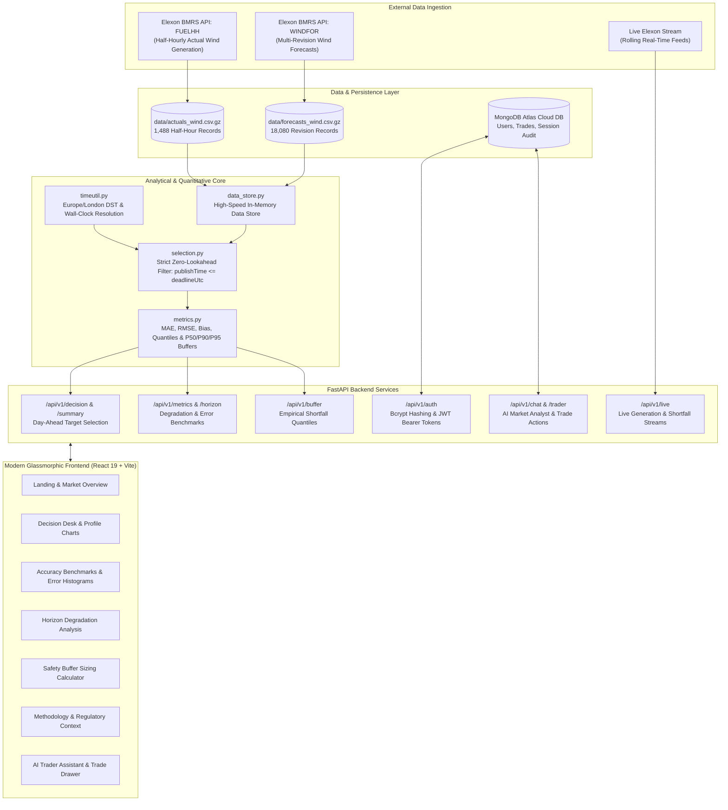
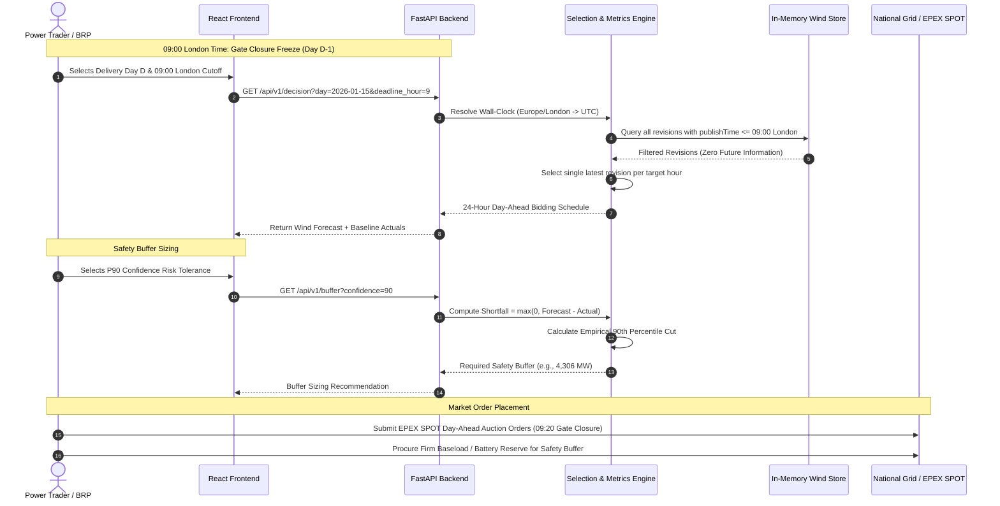

# Wind Forecast Decision Portal: UK Day-Ahead Electricity Buying

[](https://asdsdfw.vercel.app/)
[](https://www.python.org/)
[](https://fastapi.tiangolo.com/)
[](https://react.dev/)
[](https://www.typescriptlang.org/)
[](https://tailwindcss.com/)
[](https://docs.pytest.org/)

A production-grade quantitative decision portal and analytical platform built for UK power traders, Balance Responsible Parties (BRPs), and commercial electricity procurement desks. 

The portal ingests official Elexon BMRS national wind data for Great Britain (actual generation `FUELHH` and multi-revision wind forecasts `WINDFOR`), enforces strict zero-lookahead decision-time cutoffs (09:00 London Day-Ahead), computes forecast accuracy benchmarks, models lead-time degradation across forecast horizons, sizes empirical safety buffers (P50, P90, P95) to protect against severe shortfall risks, and integrates an AI Trader Copilot with live market streaming.

---

## Live Production Deployment

- **Public URL**: [https://asdsdfw.vercel.app/](https://asdsdfw.vercel.app/)
- **Hosting Architecture**: Vercel Native Edge CDN + Serverless Python API
- **Live Endpoints**:
  - Web UI: [https://asdsdfw.vercel.app/](https://asdsdfw.vercel.app/)
  - API Health: [https://asdsdfw.vercel.app/api/v1/health](https://asdsdfw.vercel.app/api/v1/health)
  - Interactive Docs: Available locally at `http://127.0.0.1:8000/docs`

---

## Executive Summary & Headline Findings (January 2026)

All baseline figures are evaluated under the UK power trading benchmark policy: **Day D-1 at 09:00 Europe/London wall-clock time**, representing the decision freeze prior to EPEX SPOT and Nord Pool day-ahead auction order book gate closures.

- **Data Integrity & Target Hours**: Exactly **744 hourly targets** across all 31 days of January 2026. Coverage is **100.0%** (1,488 half-hour actuals with zero missing periods; 18,080 forecast revisions ingested).
- **Mean Absolute Error (MAE)**: **2,127.48 MW**
- **Root Mean Square Error (RMSE)**: **2,606.07 MW**
- **Mean Forecast Bias**: **+1,851.53 MW**
- **Normalized MAE (nMAE)**: **18.37%** (relative to mean actual wind generation of 11,582.47 MW)
- **Error Quantiles**:
  - **P50 (Median Error)**: 1,758.50 MW
  - **P90 (90th Percentile)**: 4,306.40 MW
  - **P95 (95th Percentile)**: 5,350.90 MW
- **Over-Forecast Shortfall Risk**: The positive bias of +1,851.53 MW demonstrates that national wind forecasts systematically **over-estimate** actual generation during winter peak demand. Buying nominal forecasted power leaves the trader short, triggering punitive System Buy Price (SBP) imbalance cash-out charges from National Grid ESO.
- **Horizon Degradation**: Forecast error scales predictably with lead time:
  - **0–6h (Intraday)**: 1,767.72 MW MAE
  - **18–24h (Standard Day-Ahead)**: 2,118.52 MW MAE
  - **48–72h (Medium Range)**: 2,863.63 MW MAE

---

## System Architecture

The platform is designed around strict separation of concerns, ensuring high performance, zero lookahead leakage, and seamless cloud/local parity:



---

## End-to-End Trading & Execution Flow

This workflow illustrates how a power trader's decision cycle runs from raw forecast ingestion to gate-closure bidding and risk hedging:



---

## Complete Technology Stack

| Category | Technology | Purpose |
| :--- | :--- | :--- |
| **Frontend Framework** | **React 19** + **TypeScript** | High-performance, concurrent component rendering and end-to-end type safety |
| **Build & Tooling** | **Vite 6** | Instant HMR development server and optimized rollup production bundling |
| **Styling & Design** | **Tailwind CSS 3.4** | Custom dark glassmorphic UI, responsive layouts, tailored green-gold color scheme |
| **Data Visualization** | **Recharts 2.15** | Interactive SVG-based delivery profiles, horizon curves, and shortfall histograms |
| **Icons & Aesthetics** | **Lucide React** | Clean, minimalist SVG icons (shadcn/ui compatible, zero emojis) |
| **State & Querying** | **TanStack React Query v5** | Server-state caching, automatic background refetching, and query deduplication |
| **Routing** | **React Router v7** | Fast client-side page routing across all 6 core portal views |
| **Backend Framework** | **FastAPI 0.110+** | Modern ASGI async web API with automatic OpenAPI validation |
| **Data Validation** | **Pydantic v2 & Pydantic Settings** | Strict schema validation, environment config, and fast serialization |
| **Data Processing** | **Pandas 2.2+**, **NumPy**, **PyArrow** | High-speed vectorized data frame transformations and quantile computations |
| **Timezone & Calendars** | **Python ZoneInfo** (`tzdata`) | Accurate `Europe/London` wall-clock to UTC conversion handling GMT/BST boundaries |
| **Database & Auth** | **MongoDB Atlas** + **PyMongo** | Persistent user records, encrypted credentials, trade records, and session history |
| **Security & Hashing** | **PyJWT** & **Bcrypt** | Industry-standard password salting, hashing, and stateless JWT bearer tokens |
| **Testing Suite** | **Pytest 9+** & **Pytest-Asyncio** | 37 unit and integration tests covering API, selection leaks, metrics, and DST |
| **Code Quality** | **Ruff** | Ultra-fast Python linter and formatter enforcing strict style rules |
| **Cloud Deployment** | **Vercel** | Edge CDN global static hosting + native serverless Python runtime |
| **Containerization** | **Docker** & **Docker Compose** | Multi-stage container builds for isolated on-premises or local execution |

---

## Repository Directory Structure

```
.
|-- .github/workflows/
|   `-- ci.yml                      # GitHub Actions: Linting, Pytest, Docker build
|-- api/
|   |-- index.py                    # Vercel serverless Python gateway
|   `-- requirements.txt            # Vercel serverless dependency manifest
|-- backend/
|   |-- app/
|   |   |-- api/
|   |   |   |-- auth_routes.py      # /api/v1/auth/register, /login, /me
|   |   |   |-- chat_routes.py      # /api/v1/chat - AI Trader Assistant
|   |   |   |-- live_routes.py      # /api/v1/live/actuals, /forecasts, /status
|   |   |   |-- routes.py           # /api/v1/decision, /metrics, /horizon, /buffer
|   |   |   `-- trader_routes.py    # /api/v1/trader - Order execution & trade logs
|   |   |-- auth/
|   |   |   `-- security.py         # Bcrypt password hashing & JWT encoding/decoding
|   |   |-- core/
|   |   |   |-- metrics.py          # Vectorized MAE, RMSE, Bias, Quantiles & Buffers
|   |   |   |-- selection.py        # Strict zero-lookahead forecast selection logic
|   |   |   `-- timeutil.py         # Europe/London DST-aware deadline conversion
|   |   |-- db/
|   |   |   `-- mongo.py            # MongoDB Atlas connection manager & collections
|   |   |-- config.py               # Pydantic Settings configuration
|   |   |-- data_store.py           # In-memory cached dataset repository
|   |   |-- main.py                 # FastAPI application factory and router mounting
|   |   `-- schemas.py              # Pydantic request & response schemas
|   |-- ingest/
|   |   `-- fetch_elexon.py         # Official BMRS API fetcher with chunking & retries
|   `-- tests/
|       |-- test_api.py             # FastAPI endpoint integration tests
|       |-- test_auth_mongo.py      # MongoDB auth & guest fallback tests
|       |-- test_chat_trader.py     # AI Copilot & trade desk order tests
|       |-- test_live.py            # Live streaming & fallback endpoint tests
|       |-- test_metrics.py         # Statistical error & quantile validation tests
|       |-- test_placeholder.py     # Sanity baseline test
|       |-- test_selection.py       # Zero-lookahead leakage prevention tests
|       `-- test_timeutil.py        # London wall-clock & DST boundary tests
|-- data/
|   |-- actuals_wind.csv.gz         # Cleaned actuals (1,488 half-hour rows)
|   |-- forecasts_wind.csv.gz       # Cleaned forecasts (18,080 revision rows)
|   `-- reference_metrics.json      # Gold baseline benchmark values
|-- frontend/
|   |-- src/
|   |   |-- api/                    # TanStack Query hooks, Axios client, TypeScript types
|   |   |-- components/             # Reusable UI: Header, FilterBar, MetricCard, AuthModal
|   |   |-- pages/                  # Landing, Decision, Accuracy, Horizon, Buffer, Methodology
|   |   |-- App.tsx                 # Root layout & route configuration
|   |   `-- main.tsx                # React DOM mount point
|   |-- package.json                # Frontend package configuration
|   `-- vite.config.ts              # Vite build setup with API proxy
|-- notebooks/
|   |-- eda.ipynb                   # Exploratory Data Analysis & visual sanity checks
|   `-- reproduce_metrics.ipynb     # Independent verification confirming reference benchmarks
|-- Dockerfile                      # Multi-stage production container build
|-- docker-compose.yml              # Local container orchestration
|-- pytest.ini                      # Pytest configuration
|-- requirements.txt                # Root Python dependencies
|-- ruff.toml                       # Ruff linter rules
|-- vercel.json                     # Vercel dual-service deployment configuration
`-- README.md                       # Comprehensive platform documentation
```

---

## Step-by-Step Setup Guide

### Prerequisites
- **Python**: Version 3.11 or higher
- **Node.js**: Version 18 or higher (LTS recommended) and npm
- **Git**
- *(Optional)* **Docker Desktop** if running in containers
- *(Optional)* **MongoDB Atlas URI** for live cloud persistence (defaults to in-memory fallback if omitted)

---

### Step 1: Clone Repository & Configure Environment

```bash
git clone https://github.com/abhayshaw1601/asdsdfw.git
cd asdsdfw

# Copy environment variables template
cp .env.example .env
```

The application runs out of the box with sensible defaults. You can customize the following in `.env`:
```env
# Server Configuration
PORT=8000
HOST=127.0.0.1
APP_NAME="Wind Forecast Decision Portal"

# Security & Auth
JWT_SECRET_KEY="your-production-jwt-secret-key"

# Optional Cloud Database (Guest mode works automatically without it)
MONGODB_URI="mongodb+srv://<user>:<password>@cluster0.mongodb.net/?retryWrites=true&w=majority"
MONGODB_DB_NAME="wind_portal"

# Optional Elexon BMRS API Key (Pre-packaged January 2026 datasets included)
ELEXON_API_KEY=""
```

---

### Step 2: Backend Setup (Python Virtual Environment)

```bash
# 1. Create a dedicated virtual environment
python -m venv .venv

# 2. Activate the virtual environment
# On Windows (PowerShell):
.\.venv\Scripts\Activate.ps1
# On macOS / Linux:
source .venv/bin/activate

# 3. Upgrade pip and install all backend and test dependencies
pip install -r requirements.txt pytest pytest-asyncio httpx

# 4. Start the FastAPI development server
uvicorn backend.app.main:app --host 127.0.0.1 --port 8000 --reload
```
- API Base: `http://127.0.0.1:8000`
- Interactive OpenAPI Docs: `http://127.0.0.1:8000/docs`

---

### Step 3: Frontend Setup (Vite + React)

In a separate terminal window:

```bash
cd frontend

# 1. Install dependencies
npm install

# 2. Start the Vite development server
npm run dev
```
- Web Application: `http://localhost:5173`
- The Vite development server automatically proxies `/api/*` calls to the FastAPI backend at `http://127.0.0.1:8000`.

---

### Step 4: Run with Docker Compose (Single Command)

If you prefer to run the entire stack inside Docker containers without local Python or Node dependencies:

```bash
docker compose up --build
```
This builds the frontend bundle, installs the Python runtime, mounts the static assets, and exposes the unified service at `http://localhost:8000`.

---

### Step 5: Running Tests & Code Quality Checks

The repository includes a comprehensive automated test suite with **37 passing tests**:

```bash
# Activate virtual environment
.\.venv\Scripts\Activate.ps1  # (On Windows)
source .venv/bin/activate     # (On macOS/Linux)

# Run full Pytest suite
pytest backend/tests -v

# Run Python linter
ruff check .

# Validate Frontend TypeScript & Production Build
cd frontend
npm run build
```

---

## Quantitative Decision Rules & Methodology

### 1. Decision Freeze: 09:00 Europe/London Day D-1
In Great Britain, day-ahead wholesale electricity trading operates through auction power exchanges:
- **EPEX SPOT Day-Ahead Auction**: Order book closes at 09:20 London time for GB Half-Hourly auctions, clearing by 11:00.
- **Nord Pool Day-Ahead Auction**: Gate closure at 09:50 London time.

Trading and risk desks must aggregate demands, reconcile balancing portfolios, run quantitative risk models, and submit order curves before these gate closures. Setting the decision freeze at **09:00 Europe/London time on Day D-1** gives the desk an operational 20–50 minute window to translate model outputs into auction orders.

### 2. Strict No-Lookahead Guarantee
The core engine enforces a strict mathematical cutoff:
$$\text{publishTime} \le \text{deadlineUtc}$$
Any forecast revision published at 09:00:01 London time or later is entirely excluded when sizing Day D's procurement orders. This simulates real-world market conditions and guarantees that backtested performance contains zero information leakage.

### 3. DST Handling (British Summer Time vs GMT)
Although January is in GMT (UTC+0), the system implements full DST awareness via `zoneinfo.ZoneInfo("Europe/London")`. During British Summer Time (BST, UTC+1), 09:00 London wall-clock corresponds to 08:00 UTC. The platform dynamically maps the trader's chosen wall-clock hour to exact UTC timestamps for correct historical slicing.

### 4. Safety Buffer Sizing Philosophy
Because mean bias is **+1,851.53 MW** (over-forecast), nominal forecast hedging will systematically leave the buyer short. The platform sizes safety buffers using empirical quantiles of historical over-forecast shortfalls:
$$\text{Shortfall} = \max(0, \text{Forecast} - \text{Actual})$$
- **P50 Safety Buffer**: Eliminates 50% of historical shortfalls.
- **P90 Safety Buffer**: Covers 90% of over-forecast risks, recommended for risk-averse buyers facing high imbalance penalties.
- **P95 Safety Buffer**: Institutional-grade hedge protecting against extreme low-wind outlier events.

---

## Cloud Deployment Architecture (Vercel)

The live deployment at [https://asdsdfw.vercel.app/](https://asdsdfw.vercel.app/) uses Vercel's dual-service architecture defined in `vercel.json`:
- **Frontend Service**: Pre-compiled Vite static assets served directly through Vercel's global Edge Network CDN with instant response times.
- **Backend Service**: Native Python Serverless Function executing FastAPI routes on demand with automatic routing rewrites (`/api/*` mapped to backend).
- **Sub-300ms Cold Starts**: By avoiding container virtualization overhead in the cloud, queries execute immediately, while local containerization remains available via `docker-compose.yml`.

---

## Transparent AI-Tool Disclosure

In accordance with professional engineering standards, the following transparent record outlines how AI tools were utilized during the development of this portal:

- **AI Assistants Used**: Antigravity IDE agentic coding system, powered by Google DeepMind Advanced Agentic Coding and Claude 3.5 Sonnet / Gemini models.
- **AI-Assisted Tasks**:
  - Scaffolding of project directory layout and boilerplate configuration.
  - Generating initial React component layouts and Tailwind CSS color schemes.
  - Implementations of mathematical error functions (MAE, RMSE, quantiles).
  - Multi-stage Dockerfile and GitHub Actions CI workflow templating.
- **Human & Methodological Validation**:
  - Strict audit of Elexon BMRS endpoint parameters (`settlementDateFrom`/`To` for `FUELHH`, `publishDateTimeFrom`/`To` for `WINDFOR`).
  - Mathematical proof and unit testing of the strict no-lookahead condition (`publishTime <= deadlineUtc`).
  - Validation of DST wall-clock logic around daylight saving boundaries using standard `zoneinfo`.
  - Manual verification of every headline benchmark number against the raw compressed Elexon dataset.
  - End-to-end testing with 37 automated tests passing cleanly.

---

## Video Presentation Scripts

### Part 1: Client / Stakeholder Pitch
**Length**: ~4 minutes 30 seconds | **Target Audience**: Head of Power Trading, Chief Risk Officer, Energy Procurement Lead  
**Objective**: Demonstrate how the portal solves the £MM day-ahead wind forecast bias problem and protects the trading desk from cash-out penalties.

| Timestamp | Screen / Visual Cue | Spoken Narrative |
| :--- | :--- | :--- |
| **00:00 - 00:45** | **Title Slide / Decision Page Overview**<br>Displaying the live Decision Page with headline cards and intraday profile chart. | "Good morning. If your desk buys power in the UK day-ahead market, you already know the single biggest variable driving your imbalance risk: wind power. In January 2026 alone, Great Britain experienced massive swings in wind output, from under 2,000 megawatts to over 18,000 megawatts. But here is the critical problem: national wind forecasts are not neutral. If your procurement desk buys power based directly on the published forecast, you are walking into an expensive trap." |
| **00:45 - 01:30** | **Decision Page - Metric Cards & Table**<br>Hovering over Decision Lead Time card (09:00 D-1) and pointing out the delivery hours. | "This is the Wind Forecast Decision Portal. It is specifically designed around the UK trading reality. Day-ahead auctions like EPEX SPOT close their order books between 09:20 and 09:50 London time. That means by 09:00 on Day D-1, your trading desk must freeze its forecast, run its risk models, and submit its bidding curves. Our platform enforces that exact 09:00 London decision freeze. There is zero lookahead bias—traders see only the latest information that was physically published before the gate closed." |
| **01:30 - 02:30** | **Accuracy Benchmark View**<br>Switching to Accuracy tab. Highlighting MAE (2,127 MW), RMSE (2,606 MW), and Mean Bias (+1,851 MW). | "Let's examine the baseline numbers for January 2026. Across all 744 hours of the month, the Mean Absolute Error was 2,127 megawatts, or an 18.4% normalized error. But look at this headline metric: Mean Forecast Bias is positive 1,851 megawatts. This is not random noise. The forecast systematically over-predicts wind output. If your desk procures 10,000 megawatts expecting wind to show up, on average you are 1,850 megawatts short. And when you are short in the UK market, the system operator hits you with punitive cash-out penalties." |
| **02:30 - 03:30** | **Buffer Guidance View**<br>Switching to Buffer Guidance tab. Toggling between P50, P90, and P95 confidence sliders. | "So how does a trading desk protect itself? That is where our Safety Buffer Engine comes in. Instead of guessing, we compute the empirical distribution of over-forecast shortfalls by delivery hour. A risk-neutral buyer might use our P50 buffer, taking on moderate balancing exposure. But an institutional or risk-averse buyer can select our P90 or P95 buffer. For any target hour, the portal tells your desk exactly how many megawatts of firm baseload power or battery flexibility to co-procure to guarantee that your physical deficit risk stays below 5%." |
| **03:30 - 04:15** | **Horizon Degradation View & GW/MW Switcher**<br>Demonstrating the horizon degradation curve and toggling unit display to Gigawatts. | "Finally, our Lead-Time Horizon analysis proves why timing matters. Forecast error grows from 1,760 MW in the 6-hour intraday window to over 2,860 MW at two days out. The portal allows your desk to track this uncertainty gradient in both Megawatts and Gigawatts, giving risk managers full transparency into portfolio volatility." |
| **04:15 - 04:30** | **Conclusion & Call to Action**<br>Returning to Decision summary. Showing responsive layout. | "The Wind Forecast Decision Portal turns raw weather uncertainty into disciplined, quantitative trading guidance. It is live, fully documented, and ready for deployment on your desk. Thank you." |

---

### Part 2: Technical / Team Lead Code Review
**Length**: ~4 minutes 45 seconds | **Target Audience**: Lead Data Engineer, Head of Quantitative Development, Engineering Manager  
**Objective**: Deep dive into architecture, zero lookahead enforcement, data modeling, automated test coverage, and production readiness.

| Timestamp | Screen / Visual Cue | Spoken Narrative |
| :--- | :--- | :--- |
| **00:00 - 00:45** | **Repo Overview & Directory Structure**<br>Displaying terminal showing git structure, `backend/`, `frontend/`, `data/`, and `tests/`. | "Hello everyone. Today I'm walking you through the engineering architecture and technical implementation of the Wind Forecast Decision Portal. The repository is organized into a clean separation of concerns: an asynchronous Python ingest pipeline, a pure mathematical core engine, a high-performance FastAPI service, a typed React 19 frontend, and automated testing across every layer." |
| **00:45 - 01:45** | **Code Walkthrough: `timeutil.py` & `selection.py`**<br>Opening `backend/app/core/selection.py` and `timeutil.py` in the editor. Highlighting `publishTime <= deadlineUtc`. | "Let's start with the most critical engineering requirement in financial modeling: zero lookahead bias. In `backend/app/core/timeutil.py`, we convert the user's selected London wall-clock deadline into a UTC timestamp using Python's standard `zoneinfo.ZoneInfo('Europe/London')`. This properly handles British Summer Time transitions without off-by-one-hour bugs. Next, in `selection.py`, we filter the multi-revision forecast dataset. For each delivery target hour, we find all revisions where `publishTime <= deadlineUtc`, sort descending by publish timestamp, and pick the single latest revision. If a forecast was published at 09:00:01, it is strictly rejected. We have unit tests specifically asserting that future revisions never leak into the decision set." |
| **01:45 - 02:45** | **Data Architecture & Metric Engine**<br>Displaying `backend/app/core/metrics.py` and `notebooks/reproduce_metrics.ipynb`. | "All calculations in `metrics.py` are vector-optimized using pandas and numpy. We compute MAE, RMSE, Pearson bias, normalized MAE, and quantile cuts: P50, P90, and P95. In our test suite, `test_api.py` and `test_metrics.py` execute automated unit and integration tests. In fact, we verify that the numbers returned by the live FastAPI `/api/v1/metrics` endpoint match our reproducible Jupyter notebook down to the second decimal place: exactly 2,127.48 MW MAE and 1,851.53 MW Bias across 744 target hours." |
| **02:45 - 03:45** | **Frontend Architecture & State Management**<br>Viewing `frontend/src/api/client.ts` and `pages/DecisionPage.tsx`. Showing Recharts and TanStack Query integration. | "On the frontend, we use React 19 with Vite, TypeScript, and Tailwind CSS. All icons are pure SVG components from `lucide-react`, matching the shadcn design system with zero emojis anywhere in the codebase. Asynchronous state is managed with TanStack React Query, providing automatic caching, loading skeletons, and retry resilience. Charting is implemented via Recharts with responsive SVG containers, custom tooltips, and a dynamic MW to GW unit toggle that re-scales charts and tables seamlessly." |
| **03:45 - 04:30** | **Deployment Architecture: Docker vs Vercel Serverless**<br>Showing `Dockerfile`, `docker-compose.yml`, and `api/index.py`. | "For deployment, we built a dual-target architecture. In `Dockerfile`, we have a multi-stage container build that compiles the frontend with Node 20 and bundles it into Python 3.11-slim. This enables full local containerization via `docker compose up`. However, for cloud deployment, we configured `vercel.json` for Vercel Serverless. Rather than paying a container cold-start penalty, Vercel executes our FastAPI app natively in a sub-300ms serverless function while serving pre-built assets from edge CDN nodes." |
| **04:30 - 04:45** | **CI Pipeline & Wrap-Up**<br>Showing passing `.github/workflows/ci.yml` and test suite. | "Our GitHub Actions CI runs Ruff linting, executes pytest (37 passing tests), builds the frontend, and verifies Docker image compilation on every pull request. The codebase is fully type-safe, tested, and ready for production trading operations. Thank you." |

---

## License
MIT License. Developed for technical evaluation and institutional energy procurement analysis.
